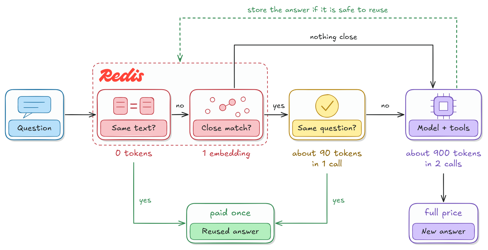
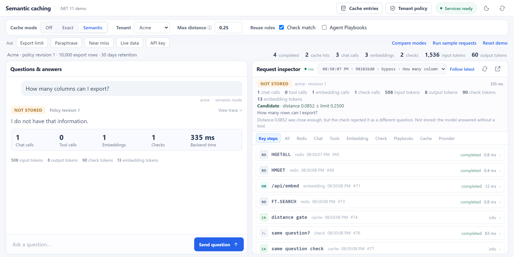
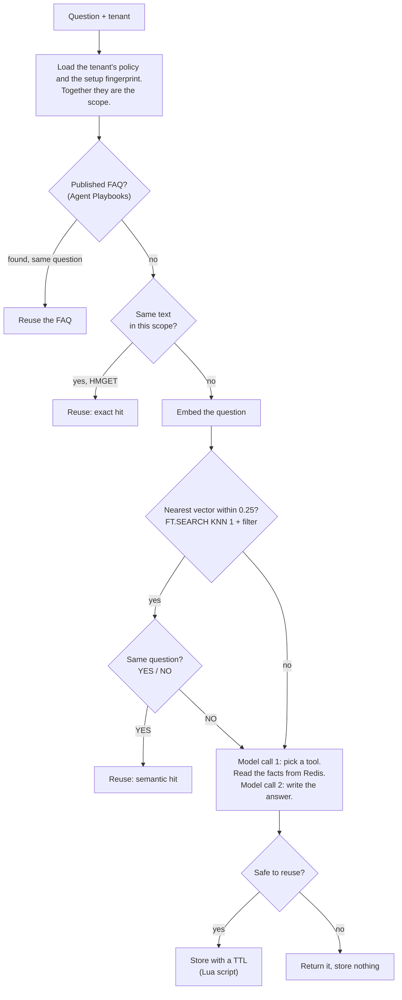
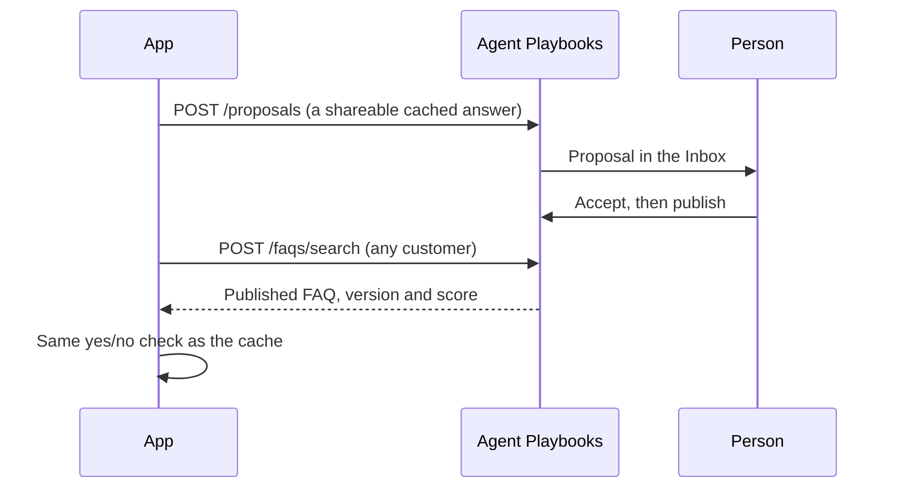
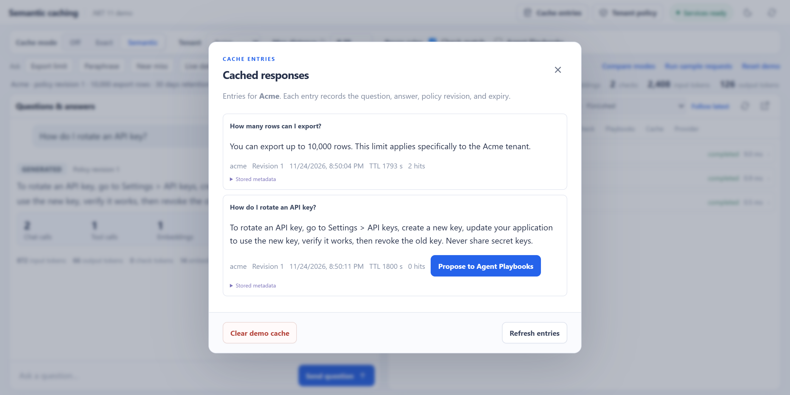
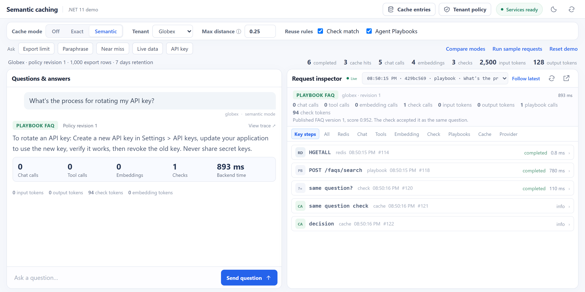

# Semantic caching in .NET with Redis

[](https://github.com/m-jovanovic/redis-semantic-caching-dotnet/actions/workflows/build.yml)

Users ask the same question in different words, and an LLM app pays for every one of them. This .NET 11 sample reuses the first answer. Redis finds a question that was asked before, a small yes/no check confirms it is the same question, and the model only runs when there is nothing to reuse.

It also publishes the best cached answers to every customer with [Redis Agent Playbooks](https://redis.io/docs/latest/develop/ai/context-engine/agent-playbooks/), after a person approves them.

I walk through the code and the demo in this video: [Semantic Caching in .NET With Redis Vector Search and Agent Playbooks](https://youtu.be/ArSfU9uzWhs).



The whole flow is four steps, and each one returns an answer or `null`:

```csharp
var reply =
    await TryPlaybookAsync(turn, ct) ??
    await TryExactCacheAsync(turn) ??
    await TrySemanticCacheAsync(turn, ct) ??
    await AskModelAsync(turn, ct);
```

- [What it saves](#what-it-saves)
- [Run it](#run-it)
- [Try it](#try-it)
- [How a request works](#how-a-request-works)
- [The concepts](#the-concepts)
- [Agent Playbooks](#agent-playbooks)
- [How good is the matching?](#how-good-is-the-matching)
- [Project structure](#project-structure)
- [Before you use this in production](#before-you-use-this-in-production)

## What it saves

Measured in the demo, with everything on one machine except Agent Playbooks:

| Question | Result | Chat calls | Chat tokens (in / out) | Check tokens | Embeddings | Time |
| --- | --- | ---: | ---: | ---: | ---: | ---: |
| How many rows can I export? | Model | 2 | 848 / 48 | 0 | 1 | 1.27 s |
| How many rows can I export? | Exact hit | 0 | 0 / 0 | 0 | 0 | 12 ms |
| What is the maximum number of rows in an export? | Semantic hit | 0 | 0 / 0 | 94 | 1 | 132 ms |
| How many columns can I export? | Near miss, rejected | 1 | 508 / 8 | 90 | 1 | 337 ms |
| What's the process for rotating my API key? (another customer) | Published FAQ | 0 | 0 / 0 | 94 | 0 | 893 ms |

Time depends on your GPU and on the distance to Redis Cloud. The token counts are what the cache changes. What that means for your bill depends on how often your users repeat themselves, so measure your own traffic before you promise a number.

A miss costs more than having no cache: you pay for an embedding and a search, and for the check when something was close.

## Run it

You need [Docker](https://www.docker.com/) and the [.NET 11 SDK](https://dotnet.microsoft.com/download). No API keys: the models run locally in Ollama.

```bash
git clone https://github.com/m-jovanovic/redis-semantic-caching-dotnet.git
cd redis-semantic-caching-dotnet

docker compose up -d
docker compose logs -f models   # wait for both models, about 3 GB the first time

dotnet run --project src/SemanticCache.Api
```

Open <http://localhost:5186>.

With an NVIDIA GPU, start the containers with `docker compose -f compose.yaml -f compose.gpu.yaml up -d`. Everything works on a CPU, only slower.

### Redis Cloud and Agent Playbooks (optional)

Copy `.env.example` to `.env` and fill in the values. Git ignores `.env`, and a value you leave as `PASTE_...` is ignored by the app. The Agent Playbooks key needs the **read** and **propose** actions and nothing more.

## Try it

Pick **Semantic** mode and the **Acme** tenant, then click through these. The inspector on the right shows every Redis command, model call and decision.

| Ask | What happens |
| --- | --- |
| **Export limit** | The model answers in two calls. The answer is stored. |
| **Export limit** again | Exact hit. One Redis read, no model, no embedding. |
| **Paraphrase** | Semantic hit at distance 0.0809. |
| **Near miss** | Distance 0.0852, almost the same. The check rejects it. |
| **Near miss** with **Check match** off | The cache answers a question about columns with a number of rows. |
| **Export limit** as **Globex** | No hit. Another customer's answer is never a candidate. |
| **Live data** | Answered, never stored. |
| Change the limit in **Tenant policy**, ask again | The old answer stops matching at once. |

A near miss with the check on. The distance passes the limit and the question is different:



The same requests are in [requests.http](requests.http).

## How a request works



Read [ChatService.cs](src/SemanticCache.Api/Features/Chat/ChatService.cs) from top to bottom. Its methods are in the order a request runs them.

## The concepts

### Scope: what may be reused, and for whom

```csharp
public sealed record CacheScope(string TenantId, int Revision, string Configuration);
```

An answer is only reused inside the scope it was created in.

- **TenantId** keeps customers apart. Acme can export 10,000 rows and Globex 1,000, so the same question has two correct answers.
- **Revision** goes up when a customer's policy changes. Old answers stop matching, and there is no invalidation step. They expire on their own.
- **Configuration** is a SHA-256 over the model digests, the prompt, the tools and the fixed facts. Change any of them and the cache starts fresh. See [CacheFingerprint.cs](src/SemanticCache.Api/Features/Caching/CacheFingerprint.cs).

### Exact lookup

```csharp
var key = keys.ForEntry(question, scope);
var values = await _database.HashGetAsync(key, fields);
```

The key is a hash of the scope and the normalized question. Same text in the same scope gives the same key, so this is one Redis read. It runs before the semantic search because it costs no tokens and no embedding.

### Embeddings and distance

An embedding model turns a question into 768 numbers. Questions with a similar meaning get vectors that point in a similar direction. Cosine distance compares the directions: 0 is identical, and bigger is further apart.

The model is `nomic-embed-text`, which expects a `search_query: ` prefix. [QuestionEmbedder.cs](src/SemanticCache.Api/Features/Caching/QuestionEmbedder.cs) calls it once per question that had no exact match.

### The index

Every cached answer is a Redis hash. This runs once, and Redis then indexes every hash with the prefix, including the ones you write later:

```csharp
object[] arguments =
[
    keys.Index,
    "ON", "HASH",
    "PREFIX", 1, keys.EntryPrefix,
    "SCHEMA",
    "tenant", "TAG",
    "revision", "NUMERIC",
    "configuration", "TAG",
    "vector", "VECTOR", "FLAT", 6,
    "TYPE", "FLOAT32",
    "DIM", options.Value.VectorDimensions,
    "DISTANCE_METRIC", "COSINE"
];

await _database.ExecuteAsync("FT.CREATE", arguments);
```

- **TAG** is an exact match. The values are hex encoded, so punctuation is never read as query syntax.
- **NUMERIC** is a range. `[1 1]` means exactly 1.
- **FLAT** compares the query with every candidate, so the result is exact. **HNSW** is approximate and suits larger sets. Redis suggests FLAT below about a million vectors.
- **DIM** has to match the embedding model.
- One vector is 768 × 4 = 3,072 bytes. 100,000 answers are about 307 MB of vectors, before overhead.

When a hash expires or is deleted, it leaves the index too.

### Semantic lookup

```csharp
var query =
    $"(@tenant:{{{CacheKeys.Tag(scope.TenantId)}}} " +
    $"@revision:[{scope.Revision} {scope.Revision}] " +
    $"@configuration:{{{CacheKeys.Tag(scope.Configuration)}}})" +
    "=>[KNN 1 @vector $queryVector AS distance]";
```

Read it as: this customer, this revision, this setup, then the one nearest vector. The filter is part of the search, so only entries that pass it come back. Filtering after the search would be wrong: the single nearest neighbor could belong to another customer, and you would miss your own.

### Why distance alone is not enough

| Asked before: "How many rows can I export?" | Distance | Same question? |
| --- | ---: | --- |
| What is the maximum number of rows in an export? | 0.0809 | yes |
| How many **columns** can I export? | 0.0852 | no |
| What's the row limit for exports? | 0.1318 | yes |

No limit separates these. A limit that accepts the third row also accepts the second, and that answer is wrong.

So a close vector is a candidate, and a model call decides:

```csharp
// YES or NO fits in three tokens.
private static readonly GenerationOptions Generation = new(Seed: 1, NumPredict: 3);

// Anything except a clear yes is a miss, and a miss only costs a normal answer.
var same = reply.Text.StartsWith("YES", StringComparison.OrdinalIgnoreCase);
```

The check costs about 90 tokens and runs only when something was close. A full answer costs about 900. See [SameQuestionCheck.cs](src/SemanticCache.Api/Features/Caching/SameQuestionCheck.cs).

### What gets stored

The prompt contains no customer data. The model calls a tool and picks a topic, and the server reads the facts for the tenant of the request. There is no tenant parameter, so a prompt cannot ask for another customer.

Where the facts came from decides whether the answer may be reused:

```csharp
return new ToolResult(
    facts,
    Reusable: SupportTopic.IsKnown(topic) && revision == policy.Revision,
    Shareable: topic == SupportTopic.ApiKeyRotation,
    PolicyRevision: revision);
```

- **Reusable**: a known topic, and the policy did not change while the model was working.
- **Shareable**: the same for every customer. Only these can be proposed as a public FAQ.
- Live data, such as the status of an export job, is never stored.
- An answer the model wrote without calling a tool is never stored.

### Storing safely

The policy can change while the model is writing. One Lua script checks the revision and writes the entry, and Redis runs it as a single step:

```lua
if redis.call('HGET', KEYS[2], 'revision') ~= ARGV[1] then
    return 0
end

redis.call('HDEL', KEYS[1], 'vector')
redis.call('HSET', KEYS[1], unpack(ARGV, 3))
redis.call('EXPIRE', KEYS[1], ARGV[2])

return 1
```

Entries expire after 30 minutes.

## Agent Playbooks

The cache is scoped to one customer and forgets after 30 minutes. Some answers are the same for everybody and worth keeping, such as how to rotate an API key. Agent Playbooks is a reviewed registry that agents can search, and this app uses its FAQs.



Only shareable answers get the button:



After a person publishes it, **Globex** asks the question in other words and reuses an answer that **Acme** paid for. Zero chat calls, zero embeddings, one check:



| | Semantic cache | Agent Playbooks |
| --- | --- | --- |
| Who decides | Code | A person |
| Who can use it | One customer | Every customer |
| How long it lives | 30 minutes | Until it is withdrawn |
| Where it runs | Any Redis with the Query Engine | Redis Cloud |

Things worth knowing:

- The app's key can read and propose. It cannot publish.
- If Agent Playbooks is down, the request continues with the cache and the model. See `TrySearchAsync` in [AgentPlaybookClient.cs](src/SemanticCache.Api/Features/Playbooks/AgentPlaybookClient.cs).
- A published FAQ can also be a near miss, so it goes through the same yes/no check.
- Proposing the same answer twice returns `409`. In testing, an already accepted proposal that was still in the **Trash** blocked a new one until I deleted it there.

## How good is the matching?

27 hand-labeled pairs, 13 that mean the same and 14 that do not, with `qwen3:4b` and `nomic-embed-text`:

| Max distance | Check | Right reuse | Wrong reuse |
| ---: | --- | ---: | ---: |
| 0.12 | off | 4/13 | 2/14 |
| 0.12 | on | 3/13 | 0/14 |
| 0.20 | off | 9/13 | 8/14 |
| 0.20 | on | 8/13 | 0/14 |
| **0.25** | off | 11/13 | **11/14** |
| **0.25** | **on** | **10/13** | **0/14** |
| 0.30 | off | 13/13 | 12/14 |
| 0.30 | on | 11/13 | 0/14 |

Without the check, every limit loose enough to be useful serves wrong answers. With it, the limit can stay loose, because the limit only picks candidates.

The set is small and written for this demo, so treat it as a way to test your own questions. The script uses the app's embedder and check:

```bash
dotnet run evaluation/evaluate.cs
```

## Project structure

| Topic | File |
| --- | --- |
| The four steps | [Chat/ChatService.cs](src/SemanticCache.Api/Features/Chat/ChatService.cs) |
| Index, exact lookup, KNN search, store | [Caching/AnswerCache.cs](src/SemanticCache.Api/Features/Caching/AnswerCache.cs) |
| The yes/no check | [Caching/SameQuestionCheck.cs](src/SemanticCache.Api/Features/Caching/SameQuestionCheck.cs) |
| Keys and normalization | [Caching/CacheKeys.cs](src/SemanticCache.Api/Features/Caching/CacheKeys.cs) |
| The two model calls | [Support/SupportAgent.cs](src/SemanticCache.Api/Features/Support/SupportAgent.cs) |
| Tools, and what may be reused | [Support/SupportTools.cs](src/SemanticCache.Api/Features/Support/SupportTools.cs) |
| Customer policies | [Policies/PolicyStore.cs](src/SemanticCache.Api/Features/Policies/PolicyStore.cs) |
| Agent Playbooks | [Playbooks/AgentPlaybookClient.cs](src/SemanticCache.Api/Features/Playbooks/AgentPlaybookClient.cs) |
| Settings | [appsettings.json](src/SemanticCache.Api/appsettings.json) |

`Infrastructure` holds configuration, the Ollama client, error handling and the request inspector. The cache uses StackExchange.Redis directly, with no AI framework and no vector library, so you can see every command.

### Tests

```bash
docker compose up -d redis
dotnet test RedisSemanticCache.slnx
```

The unit tests need nothing. The integration tests run against a real Redis and cover the scope filters, expiry and the race between a policy change and a store.

## Before you use this in production

- **Take the tenant from the signed-in user.** Here it is a dropdown.
- **Add authentication.** The demo has none and is meant for localhost.
- **Use your own database for customer data.** Here it is a Redis hash, to keep the sample small.
- **Cache only answers you can explain.** Start with facts that have a version, and leave live data out.
- **Handle a stampede.** Ten identical questions at the same moment all miss and all pay.
- **Plan for conversation history.** Every message here is an independent question. "And for imports?" means nothing without the previous turn, so its text alone must not be the cache key.
- **Measure wrong reuse, and not only the hit rate.** A cache that answers everything has a great hit rate.

## License

[MIT](LICENSE). Redis and the Redis logo belong to Redis Ltd.
